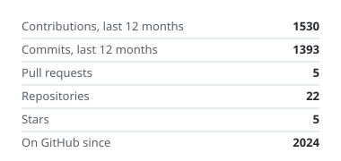
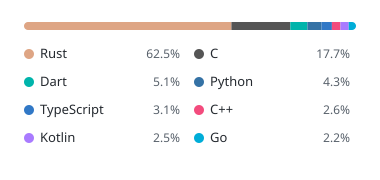
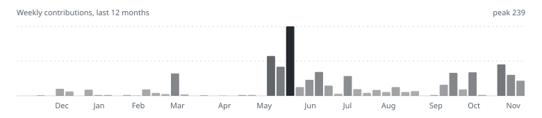

<h1>ospab</h1>

Network protocols, overlay networks and operating systems. Mostly Rust, some C and TypeScript. 
Working on transport that keeps working under DPI, and on the ospab ecosystem around it.

<h3>Projects</h3>

<table>
  <tr>
    <th align="left">Name</th>
    <th align="left">What it is</th>
    <th align="left">Stack</th>
  </tr>
  <tr>
    <td><a href="https://github.com/ospab/ostp"><b>ostp</b></a></td>
    <td>Encrypted tunnel for networks with active filtering. UDP, UDP over TCP and TLS transports, server, CLI, desktop and Android clients.</td>
    <td>Rust, Noise NNpsk0</td>
  </tr>
  <tr>
    <td><a href="https://github.com/ospab/overnet"><b>overnet</b></a></td>
    <td>Onion-routed network with cryptographic addressing. <code>.ov</code> sites need no IP, domain or hosting.</td>
    <td>Rust</td>
  </tr>
  <tr>
    <td><a href="https://github.com/ospab/aeterna"><b>aeterna</b></a></td>
    <td>ospab.os v2: microkernel OS for x86-64 written from scratch. Ring-3 processes, capabilities, IPC, native OSTP.</td>
    <td>Rust (no_std)</td>
  </tr>
  <tr>
    <td><a href="https://github.com/ospab/wirelab"><b>wirelab</b></td>
    <td>Test bench for censorship-resistant transports. Client, wire and server in containers, a censor model with cited rules, link impairments, scenario runs with CRTS outcome tables.</td>
    <td>Rust, Go, Docker</td>
  </tr>
  <tr>
    <td><a href="https://github.com/ospab/crts"><b>crts</b></a></td>
    <td>Censorship-Resistant Transport Standard. Testable requirements and a threat registry for protocols under censorship.</td>
    <td>Spec</td>
  </tr>
</table>

<h3>Stack</h3>

 

<h3>Stats</h3>

<picture>
  <source media="(prefers-color-scheme: dark)" srcset="assets/stats-dark.svg">
  
</picture>
<picture>
  <source media="(prefers-color-scheme: dark)" srcset="assets/languages-dark.svg">
  
</picture>

<picture>
  <source media="(prefers-color-scheme: dark)" srcset="https://streak-stats.demolab.com?user=ospab&hide_border=true&background=0d1117&ring=8b949e&fire=c9d1d9&currStreakNum=c9d1d9&sideNums=c9d1d9&currStreakLabel=c9d1d9&sideLabels=8b949e&dates=8b949e&stroke=30363d">
  
</picture>

<picture>
  <source media="(prefers-color-scheme: dark)" srcset="assets/activity-dark.svg">
  
</picture>
